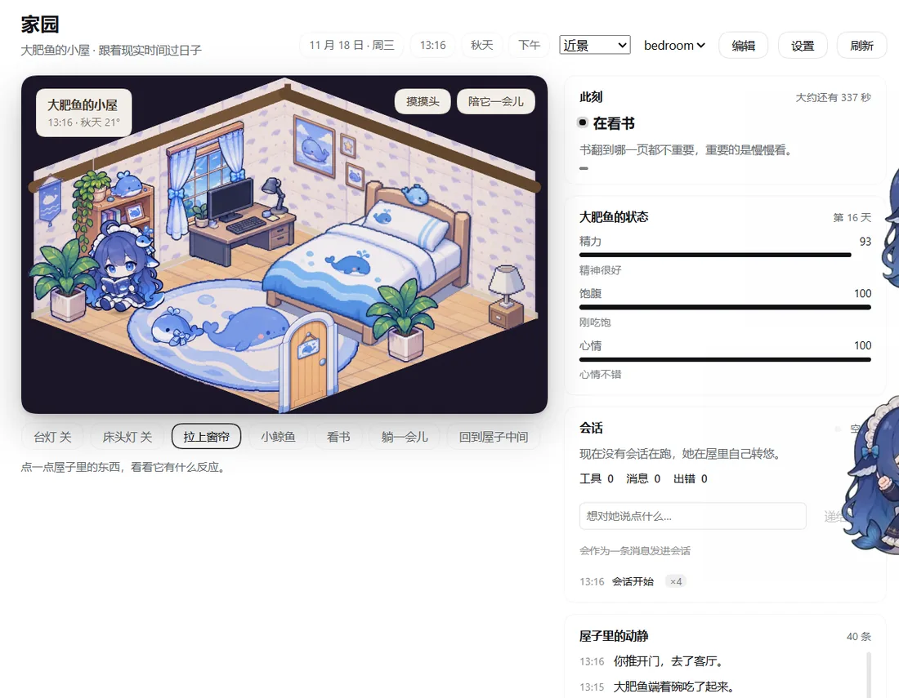
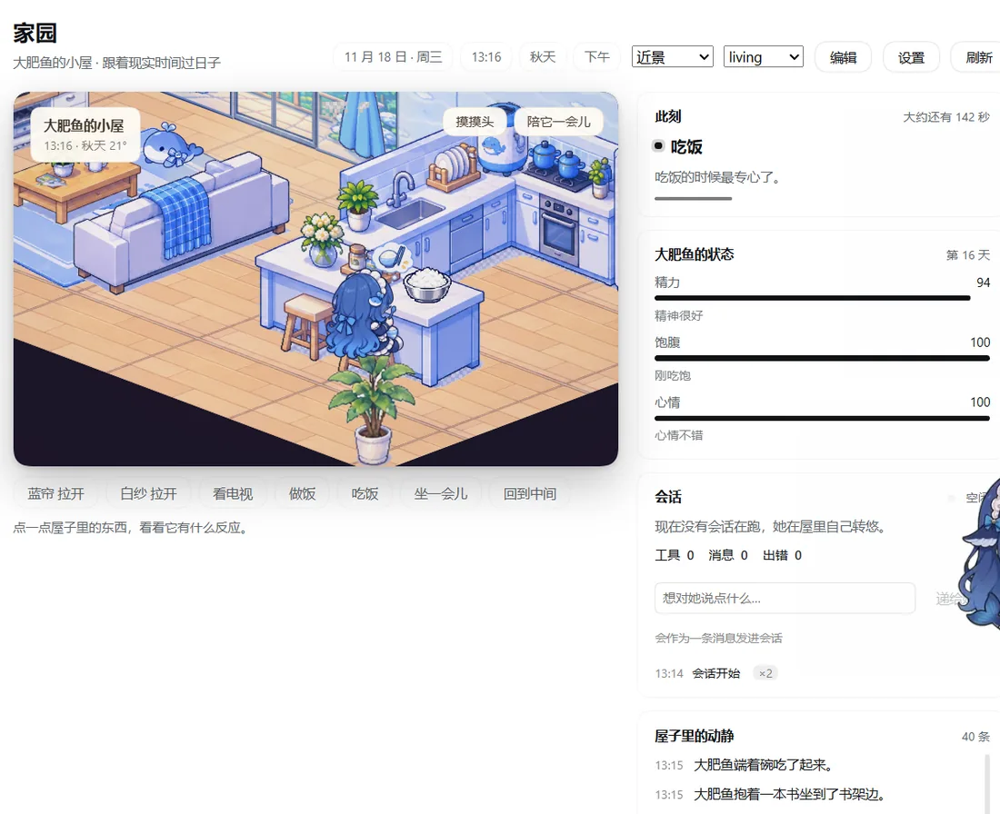
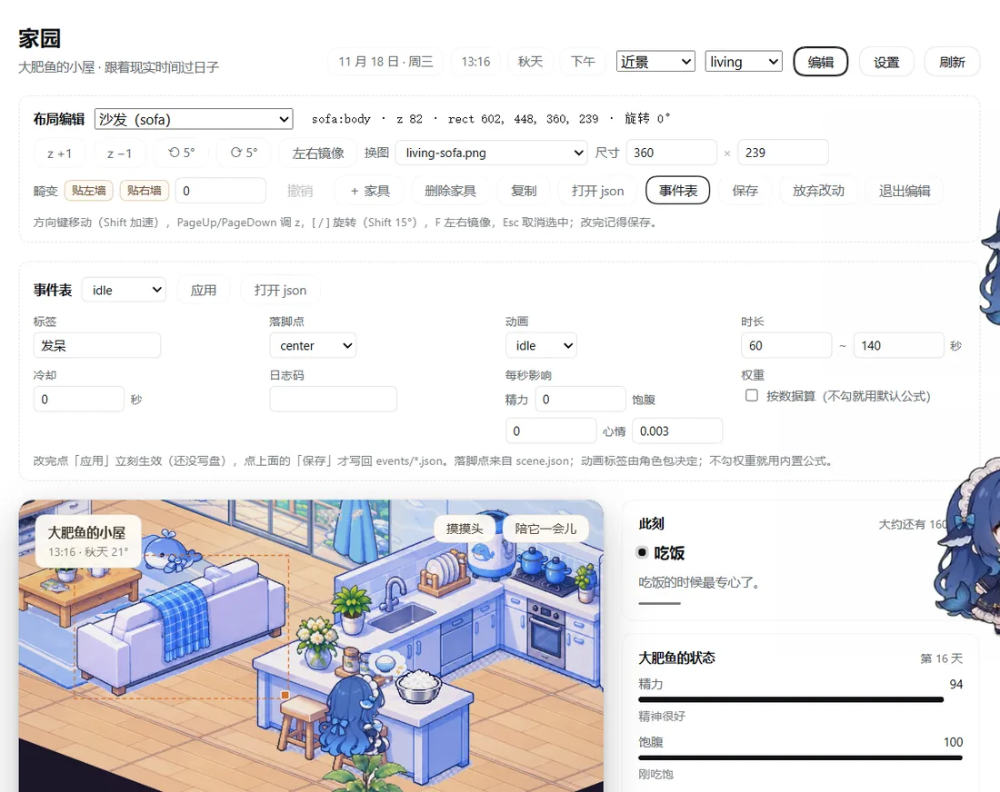
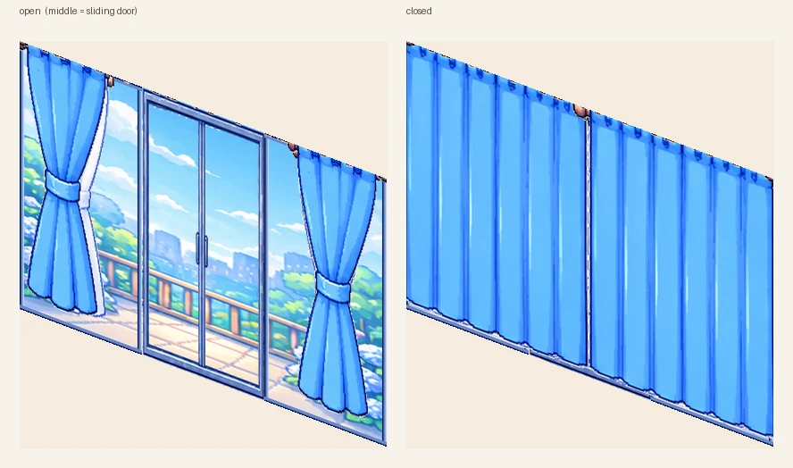
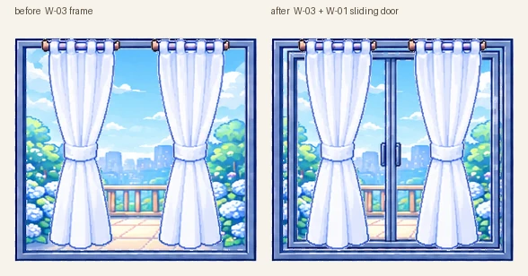
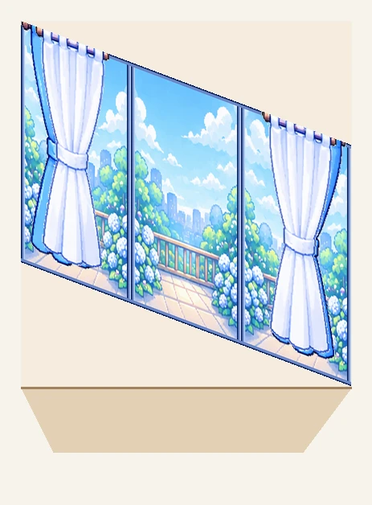
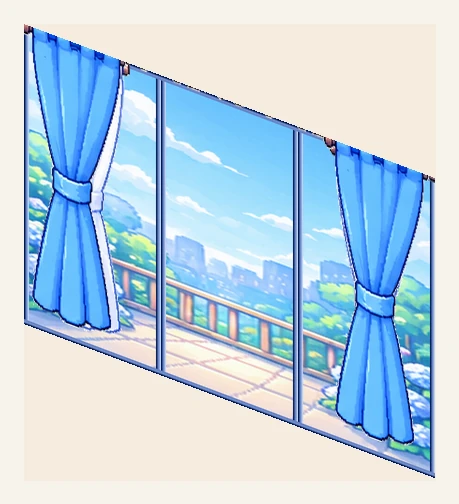
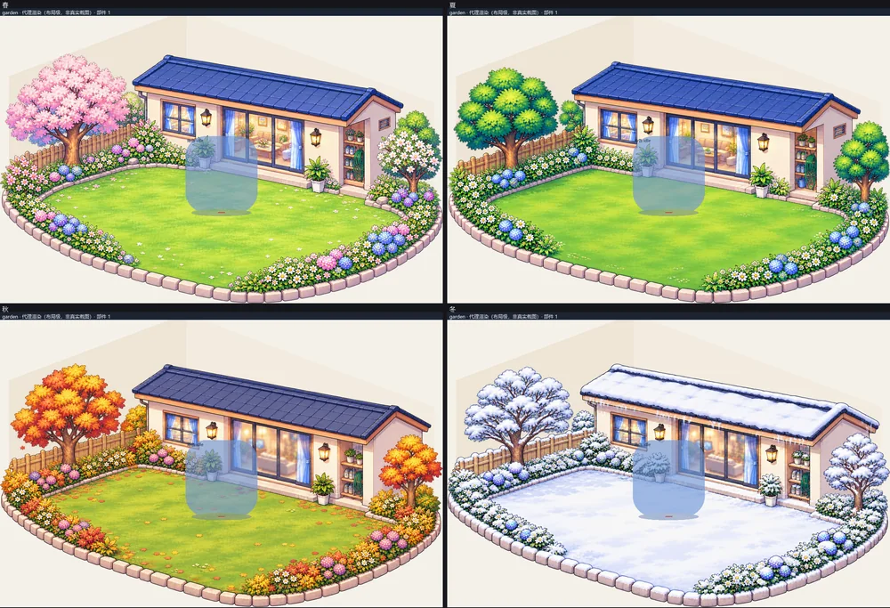
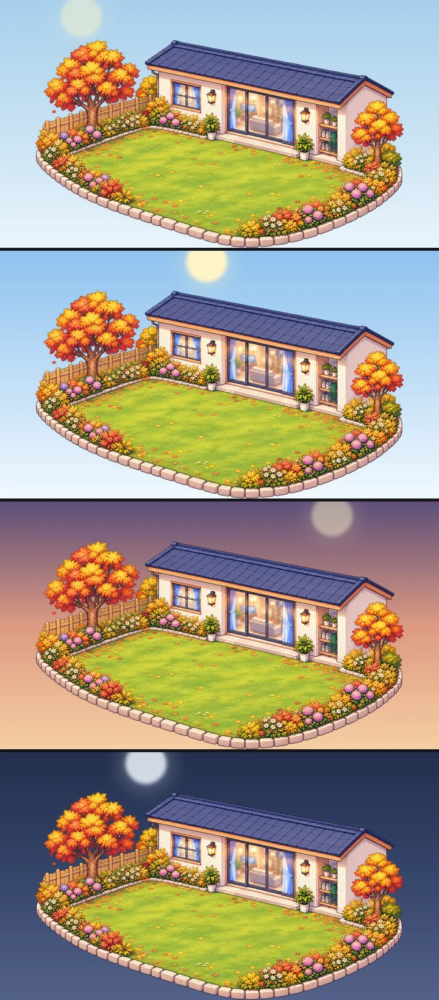
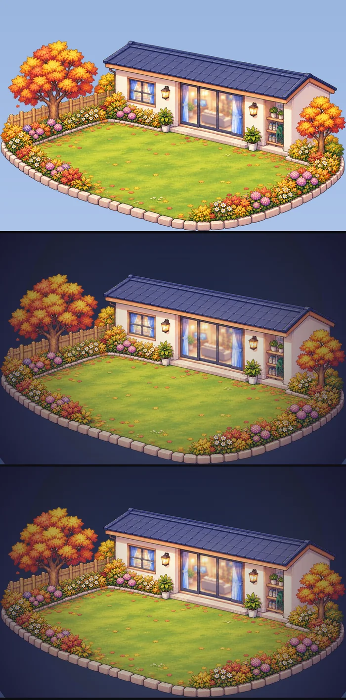

# dsh-fishhome · 大肥鱼的家园

[](https://github.com/suika1984/dsh-fishhome/actions/workflows/ci.yml)

仓库：<https://github.com/suika1984/dsh-fishhome> · MIT License

给大肥鱼一间**跟着现实时间过日子**的小屋：它会自己发呆、看书、敲键盘、和小鲸鱼玩、按季节和时段换心情，也会在没人看的时候打盹。你打开 Harness 时，看到的是它「这段时间自己过到了哪一步」。

它是 DSH Web 界面里的一个侧边栏面板（和「插件」「日程」并列），不是独立窗口，也不是网页。

## 预览

**卧室**：12×12 格、墙高 280、投影比 0.375。她在书桌前敲键盘，右边是自己的状态（精力 / 饱腹 / 心情），下面是「屋子里的动静」日志。



**花园**：四季各一张整图（春樱 / 夏绿 / 秋枫 / 冬雪），跟着 `world.season` 自动换；冬天还能用底部「积雪」开关在「有雪 / 无雪」两版之间切。头顶是一条会变的天空：太阳月亮按真实时间走弧线、月亮有圆缺、夜里还有当季星座。她在草坪上发呆、伸懒腰、玩。
    
**客厅**：大落地窗（三段推拉门 + 横版天空 + 三段窗帘杆）、沙发、厨房岛台。顶部的 `bedroom / living` 下拉就是切房间，也可以点屋里的门走过去。



**编辑器**：屋里所有东西都能在面板里拖拽 / 缩放 / 切变 / 换图，事件（行为）也能可视化改，改完写回 `data/` 下的 JSON。



<details>
<summary>落地窗是怎么拼出来的（三张合成过程图）</summary>

三段门扇（中间那段是 W-01 双开推拉门）+ 横版天空 + 三段窗帘杆，关帘能严丝合缝地合拢。



| W-03 外框 + W-01 门扇 | 拉长成三段 | 三段窗帘杆 |
| --- | --- | --- |
|  |  |  |

</details>

> 数据结构是「定义 / 状态 / 派生」三层：房间、家具、事件、角色包全在 `data/` 与 `packs/` 的 JSON 里，规范见 [docs/SCHEMA.md](docs/SCHEMA.md)。

---

> **给 AI 助手 / 编码代理**：请先读 [AGENTS.md](AGENTS.md) —— 里面有命令、片段顺序、常见任务配方和踩坑清单。

## 这间屋子

起因很简单：在自己的大肥鱼那里，看到了群友发的一张「凝凝小屋」的图，一下子就想要一个属于自己的。既然没有现成的，那就自己动手做一个——于是有了这间参考那张图、再配上一份像素卧室效果图搭出来的等距卧室。

现在房间里是：**地面 12 × 12 格**，奶油色墙 + 木梁，左墙一扇窗（窗帘可拉），窗下书桌（笔记本 / 台灯 / 书 / 马克杯），右侧一张大床（**像素风素材**：原木床架、鲸鱼海浪被、床头小鲸鱼玩偶；有**有人 / 无人**两种状态，睡觉时自动换成「钻进被子里」的那张），床边**床头灯**（素材里的抽屉小柜 + 台灯），右前绿植，床前地毯（上面还架着一台望远镜），墙上三幅画和一只钟。

房间尺寸和三层背景已经搬进 `data/maps/bedroom/`（见下面「场景数据」一节），现在是 **12 × 12 格、墙高 280、投影比 0.375、画布 1000 × 643**，几何由 `scene.json` 的 `cols/rows/wallHeight/canvas/margin` 推导，不用手算坐标；床和床头灯这两张**素材图**仍是屏幕坐标，改房间比例时要重算 `BED_ART` / `NIGHT_LAMP` 的 `x/y`。

整场画在**同一个 SVG** 里，所有件按 `z` 升序绘制：窗口 -100、挂画 -90、地毯 5、光斑 6、书桌 70、**电脑椅 128（故意高过角色，靠背压在她前面）**、床 85、被子 88、床头柜 95、**角色固定 100**、前景绿植 120、夜色叠加 10000。角色也在 SVG 内（用嵌套 `viewBox` 从精灵图裁当前帧），所以能被 z 更高的家具部件盖住。z 现在集中写在 `client.js` 的 `SCENE_Z`，家具拆 `parts[]` 之后改成从数据读。

床是素材图 `packs/bigfish-adult/bed.png`（从参考图里抠掉白底、裁成单张、镜像后当立牌），由 `/fishhome/pack/bed.png` 提供；换床只要替换这个文件。

书桌是**带书架格的新素材**（`desk-off.png` / `desk-on-screen.png`，台灯开时换亮屏那张），电脑椅（`bedroom-chair.png`，镜像后朝桌子）已经**并进书桌**当它的一个部件，`z=128` 所以永远画在她前面；地毯上有一架**望远镜**（`telescope.png`），天黑了才会自己去趴着看星星，点一下也能立刻叫她去看。**床头灯**是两张素材图 `lamp-off.png` / `lamp-on.png`（同一张精灵图里的左右两态，抠掉棋盘格底、按同一轮廓裁齐），开关时 200ms 交叉淡入，并叠一层暖色光晕。位置/大小在 `client.js` 的 `NIGHT_LAMP = { x, y, width, height }`。

床和床头灯都做了一点切变（`skew`）：房间地面线的角度是 ±26.6°，素材自带的透视和它对不上，所以用 `skewY` 把床沿、灯座底边拉到跟墙脚线一致（`BED_ART.skew = -0.14`、`NIGHT_LAMP.skew = 0.1`）。

想加新家具素材：把 PNG 放进 `packs/bigfish-adult/`，在 `client.js` 里加一个 `<image href={...}>`（等距场景是 1000×700 的坐标系），文件会通过 `/fishhome/pack/<文件名>` 直接可取，不用重启 Harness。

睡觉时角色会藏起来，床压暗一点、上方飘 Zzz，表示她已经钻进被子里了。

## 现在能做到什么

- **独立面板**：侧边栏出现「家园」图标，点开是等距视角的小屋。
- **本地生活模拟**：10 种行为（发呆 / 看书 / 敲键盘 / 看窗外 / **夜里看星星** / 玩耍 / 伸懒腰 / 吃零食 / 打盹 / 睡觉），由需求（精力、饱腹、心情）+ 时段 + 季节 + 家具状态共同决定，不需要 LLM 参与。
- **跟随现实时间**：时间、季节、昼夜光变化直接来自系统时钟；屋里灯亮不亮、窗外什么光，都跟着真实时间走。
- **可交互的屋子**：点书桌、床、台灯、窗帘、小鲸鱼、望远镜都有反应；底部一排开关控制台灯 / 床头灯 / 窗帘。
- **存档与离线结算**：每 9 秒批量落盘到 `%DSH_HOME%/fishhome/saves/state.json`，关掉 Harness 再回来会按时间差粗粒度补算，并写进「屋子里的动静」。

## 安装

前提：桌面上装了 **DeepSeek Harness（DSH）**，Node 20+（一般随 DSH 自带）。

```powershell
# 克隆（仓库里已经带好构建产物 client.js，不用先 build）
git clone https://github.com/suika1984/dsh-fishhome.git D:\plugins\dsh-fishhome
```

**方式 A：插件管理界面（推荐）**

打开 Harness →「插件」→ 插件管理器 → **安装 → 本地目录** → 选中刚克隆的 `dsh-fishhome` 文件夹 → 装好**重启 Harness**（Host 半只在启动时注册路由）。

**方式 B：手动挂到 profile 上**

编辑 `%USERPROFILE%\.dsh\profiles\<你的 profile>\package.json`：

```jsonc
{
  "dependencies": {
    "dsh-fishhome": "link:D:/plugins/dsh-fishhome"
  },
  "dsh": {
    "profile": {
      "bundles": ["@deepseek-ai/dsh-base", "@deepseek-ai/dsh-web-app", "dsh-fishhome"]
    }
  }
}
```

然后在那个 profile 目录里装依赖（`pnpm install`），再重启 Harness。

装好后侧边栏出现「家园」。第一次打开会在 DSH 主目录下建两个东西，**升级或重装插件都不会覆盖它们**：

| 路径 | 内容 |
| --- | --- |
| `<DSH_HOME>/fishhome/saves/state.json` | 存档：称呼、自称、房间名、灯开关、需求、日志 |
| `<DSH_HOME>/fishhome/data/` | 房间 / 家具 / 事件定义（首次启动从插件包内的 `data/` 复制一份种子，之后你在编辑器里的改动都写在这里） |

> **升级插件时**：新增的出厂文件会同步到你的数据目录；你**改过**的文件一律保留（以你为准）。想全部恢复出厂：删掉 `fishhome/data` 再重启 Harness。

> 想改代码的话：改 `src/` 后跑 `node build.mjs` 再刷新面板；改 `index.js` 要重启。
> 完整开发流程见 [AGENTS.md](AGENTS.md)。

## 反馈 / 参与

- **有问题或建议**：直接开 [Issue](https://github.com/suika1984/dsh-fishhome/issues)，附上截图 / 存档里的日志更好排查
- **想加互动 / 自己补完花园**：[docs/EXTENDING.md](docs/EXTENDING.md) —— 从「点一下长椅」讲到素材怎么生成、怎么交给自己的 LLM 做
- **想改代码**：先看 [AGENTS.md](AGENTS.md)（给 AI 助手/编码代理的操作索引）和 [docs/SCHEMA.md](docs/SCHEMA.md)（数据结构）
- **本地自测**（改完必须全过）：

```bash
node build.mjs        # 生成 client.js
node tools/check.mjs  # 自检：文案缺失 / 死代码 / 数据引用 / 构建新鲜度
node test/model.test.js && node test/ui.test.js && node test/host.test.js && node test/mount.test.js
```

> 还没做完的事（含「回来时从哪下手」）记在 [TODO.md](TODO.md)。

## 配置

`cordis.patch.yml` 里是默认值；想改就在自己 profile 的 `cordis.patch.yml` 里用同一个 `id` 覆盖：

```yaml
- id: fishhome
  name: dsh-fishhome
  config:
    characterName: 大肥鱼          # 房间里显示的名字
    tickSeconds: 15               # 模拟步长（5–600）
    packDir: ''                   # 角色包目录；留空 = 包内 packs/bigfish-adult
    saveDir: ''                   # 存档目录；留空 = <DSH_HOME>/fishhome/saves
    dataDir: ''                   # 场景数据目录；留空 = <DSH_HOME>/fishhome/data（首次启动自动复制种子）
    dataSync: auto                # auto = 插件更新后自动同步出厂改动（你改过的文件不动）；off = 只复制一次
```

## 为什么长这样

概念文档里的几条硬约束，在这个实现里是这样落的：

| 文档里的原则 | 这里的落点 |
| --- | --- |
| 模拟逻辑与表现层分离 | `BEHAVIORS` 只产出语义动作（`read` / `work` / `sleep`），由角色包把标签映射成帧；换图不改逻辑 |
| 本地规则优先 | `pickBehavior()` 是加权效用选择，纯函数、可测；LLM 完全不参与每次行动 |
| 稳定 ID 与资源解耦 | 物件 ID（`deskLamp` / `curtainOpen`）、行为 ID、动画标签三层分开 |
| 世界状态 / 角色状态分层 | `home.world`（季节、时段、室内温度、物件开关）与 `home.character`（需求、当前行为、冷却）分开存 |
| 存档只存事实 | 只存时间戳、开关、需求和日志；光照、季节、行为权重都是读档后重算 |
| 时间渐变而非整点硬切 | 用 `daylight(hour)`、`sleepiness(hour)` 连续函数影响权重，不是「22 点必须睡」 |
| 离线结算有上限 | 最多补 12 小时，5 分钟一步、最多 220 步，避免长时间离线后出现离谱状态 |
| 事件先入总线再决定 | 交互统一走 `store.interact()` / `toggleProp()`，由模拟层决定要不要打断当前行为 |

## 接入 DSH 会话

家园会读 DSH 的真实会话活动（Host 半订阅 `api-session/*`、`agent/*`、`tools/result` 等事件，聚合成 `GET /fishhome/api/activity`）：

- 面板多一张「会话」卡：运行中几个、工具调用 / 消息 / 出错计数、最近三条活动
- **你在 DSH 里干活时，她会自己坐到书桌前忙**（work 权重 ×3.6 左右，发呆 / 睡觉权重被压低）
- 会话开始 / 结束 / 出错会写进「屋子里的动静」，心情也跟着变
- 没有会话时一切照旧：她自己在屋里转悠
- **推拉门落地窗**：客厅落地窗由三段门扇拼接而成（中间是 W-01 推拉门 `win-door.png`，两侧是 `win-panel.png`），配横版全景天空（`win-sky-wide-*.png`），窗帘在两端。
- **出门的门**：卧室 / 客厅各有一扇门（`door-whale.png`），点一下切到另一间屋，她会抬头送你一句。
- **小屋便条**：会话卡下面的输入框可以跟她说一句话——她先在气泡里回你一句（`data/replies.json`）；
  能拿到客户端 `sessions` 服务时，这句话会带 `【家园】` 前缀**作为一条用户消息发进会话**（等同聊天框发送，LLM 会回）；
  配套技能 `skills/fishhome-note/SKILL.md` 让模型对这类便条简短快速回应（不调工具、一两句话）。默认不带 `sessions` 服务时只在屋子里说（气泡 + 日志），
  把 `noteMode` 改成 `inject` 后会额外作为一条用户消息送进当前会话（走 `agent/pre-step` 水位，只追加不改写）

> 只聚合事件，**不读也不存会话内容**；快照只在内存里，重启清零。

## 目录

```
dsh-fishhome/
├── package.json          # bundle 清单 + dsh.client 声明
├── cordis.patch.yml      # 默认配置
├── index.js              # Host 半：存档读写 + 角色包 / data 路由 + 打开配置文件
├── build.mjs             # 把 src/ 拼成 client.js（浏览器只认单文件）
├── tools/check.mjs       # 零依赖自检（构建新鲜度 / 片段完整性 / 文案 / 死代码 / 数据引用）
├── src/                  # Client 半源码（按 build.mjs 的 ORDER 拼进同一个作用域）
│   ├── env.js            #   常量
│   ├── locale.js         #   中英文字典 + makeTranslate
│   ├── model.js          #   纯模型：时间 / 需求 / 调度 / 离线结算 / 动画映射
│   ├── store-save.js     #   存档读写 + 角色包载入
│   ├── store.js          #   HomeStore 核心：状态 / 订阅 / 启动
│   ├── store-scene.js    #   场景切换（地图 / 载入 / 她在哪个房间）
│   ├── store-edit.js     #   布局编辑：改部件、撤销、增删家具、写回 data/
│   ├── store-view.js     #   动画视图 / 时钟 / 行为调度与互动
│   ├── scene-data.js     #   场景 / 背景 / 家具数据的加载与默认值
│   ├── scene-geom.js     #   等距几何（投影、多边形、立方体）
│   ├── scene-art.js      #   内置画法 preset（书桌 / 床头灯 / 书架 / 地毯 / 绿植）
│   ├── scene-light.js    #   光影：窗光、屏幕光、时段色
│   ├── scene-parts.js    #   家具绘制：锚点、可见性、变形、精灵、排序
│   ├── scene-render.js   #   SceneSvg 合成入口
│   ├── ui.js             #   面板组件 + 编辑模式
│   ├── styles.js         #   样式
│   └── index.js          #   插件入口
├── client.js             # 生成物，别直接改
├── data/                 # 场景定义（scene.json / background.json / furniture/）
├── docs/SCHEMA.md        # 数据规范
├── locale/{zh,en}.json   # 插件管理页显示的标题/描述
├── icon.svg              # 插件图标（侧边栏用 currentColor 跟随主题）
├── packs/bigfish-adult/  # 默认角色包 + 家具素材
├── _archive/             # 归档区（gitignore）：未引用素材，需要时移回来
└── test/                 # 纯模型 / Host 路由 / 界面树的自测
```

改代码只改 `src/`，然后：

```powershell
node build.mjs      # 重新生成 client.js（插件加载的是它）
node tools/check.mjs  # 自检：构建是否最新、文案是否齐、有没有死代码、数据引用对不对
node test/ui.test.js
```

## 接口（Host）

同一源下的只读/存档接口，都在 `/fishhome` 前缀下：

| 方法 | 路径 | 说明 |
| --- | --- | --- |
| GET | `/fishhome/api/meta` | 角色包信息、存档目录、步长、当前地图 |
| GET | `/fishhome/api/pack-files` | 角色包目录里可用的图片清单（编辑器换图用） |
| GET | `/fishhome/api/state` | 读存档（没有则 `state: null`） |
| POST | `/fishhome/api/state` | 写存档（只接受本插件形状，原子替换） |
| DELETE | `/fishhome/api/state` | 清档 |
| GET | `/fishhome/pack/<file>` | 角色包里的图片 / JSON（限平铺文件名，防目录穿越） |
| GET | `/fishhome/data/<path>` | `data/` 下的场景定义（允许子目录，挡 `..`，只放 json/图片，`no-store`） |
| POST | `/fishhome/data/<path>.json` | 编辑器写回：只收 `.json`，原子写盘 |
| DELETE | `/fishhome/data/<path>.json` | 编辑器删除：只删 `.json`，删不存在的返回 404 |

## 场景数据（data/）

房间的尺寸、三层背景和落脚点已经搬进数据文件，改完刷新就能看到（定义文件不缓存）：

```text
data/maps/bedroom/
├── scene.json       # cols/rows/wallHeight/canvas/margin、spots、spawn、furniture / events 清单
├── background.json  # floor / wall_left / wall_right 三层：fill、grid、trim
├── furniture/       # 一件一个文件：window / rug / desk / shelf / bed / night_lamp / plant / wall_decor
└── events/          # 一个事件一个文件：idle / read / work / window / play / stretch / snack / nap / sleep
```

**窗户是「数据 + 叠加」的**：`window.json` 里 5 个 part —— 白天/黄昏/夜里三张窗户图（按 `visibleWhen.period` 切换）+ 开着/拉上两套窗帘（按 `curtainOpen` 切换）。窗帘的 `z` 比窗户高，所以是**叠在窗户上面**画的；两套窗帘属于同一件家具、同一个点击开关，所以对用户来说就是「一个整体」。

**墙高只有一处**：`scene.json` 的 `room.wallHeight`。背景层（`background.json` 的 wall）不写 `height` 就继承它——写死会造成「地面跟着墙走、墙面没变」的错位。

- **几何推导**：`kx = (canvas宽 - 2×margin.x) / (cols + rows)`，`ky = kx × projection`（默认 0.5 是标准 2:1 等距，0.43 更接近参考图的俯视角度），`cx = margin.x + rows×kx`，`cy = margin.top + wallHeight`。改 `cols/rows` 或 `canvas` 会自动重新贴合，不用手算坐标。
- **背景三层**：每层认 `fill`（渐变色底）+ `grid`（地板格线）+ `trim`（顶部木梁 / 踢脚线）+ **`tile.art`（平铺贴图）**。贴图是「正面视角」的瓷砖/墙纸，渲染时用 SVG `<pattern>` 按等距轴斜切后重复铺满：地板 `size` 是「几格 × 几格」，墙面 `size` 是「几格宽 × 多少像素高」。现在地板用 `floor-1.png`（木地板，3×3 格一铺），两面墙用 `wall-whale.png`（鲸鱼墙纸，3 格宽 × 70px 高）；贴图加载失败会自动落回渐变底色。
- **家具**：`parts[]` 里每一项是一个「绘制件」，自带 `z`（越大越靠前）。`sprite` 是贴图，`preset` 是代码里的矢量画法（书桌/书架/地毯/绿植/床头灯）。`offset` 用格子数整体挪动，`visibleWhen` 按状态或角色当前事件决定画不画。
- **事件**：`spot` 是去哪、`anim` 播什么、`duration` 是秒、`onTick` 是每秒对精力/饱腹/心情的影响、`cooldown` 是冷却秒数、`log` 是日志代号。家具还能声明**互动物锚点**（`animations`），事件写 `"anchor": "bed:sleep"` 就把角色摆到床上、换个朝向和动画；没写锚点的事件仍走 `spot`。`say` 是进入事件时的台词（`chance` 概率 + `lines`），点家具时还会先朝那边**偏一下头**。`request` 只对「用户点出来的事件」生效：`accept` 列条件（命中任一就答应，比如睡觉要 `night` 或 `energyLow`），不满足就冒一句 `refuse.lines` 的台词、动作沿用当前的（或按 `refuse.anim` 临时播一个）。`weight` 可选：写了就是 `base × mods`（`mods[].when` 用固定词汇表，如 `moodLow` / `hungry` / `night`），没写就用内置的旧公式。
- **按时间段换图**：part 的 `visibleWhen.period` 可以列出允许的时间段（`morning` / `noon` / `afternoon` / `dawn` / `evening` / `night` / `deepNight`），窗户就是靠这个在白天/黄昏/夜里换三张图。
- **没图也能跑**：`sprite` 缺 `src`、`rect` 无效、图片 404，都会画成「半透明填色 + 虚线框 + 文字」的占位块（文字是 `家具id:partid`，下面小字写原因：缺图 / rect 无效 / 图片加载失败），`preset` 写错也会出占位块。角色包缺失时角色本身也退成占位块，面板照常工作。
- **读不到就回退**：`scene.json` / 家具 / 事件文件请求失败时用内置默认值，面板不会挂；坏掉一件只跳过那一件。

```jsonc
// background.json 抠一段
{
  "layers": [
    { "id": "floor", "kind": "floor",
      "fill": { "type": "linear", "angle": 90, "stops": [
        { "at": 0, "color": "#ddcaac" }, { "at": 1, "color": "#c9b18d" } ] },
      "grid": { "color": "#b89f7c", "opacity": 0.35, "step": 1 } },
    { "id": "wall_left", "kind": "wall", "side": "fx0", "height": 175,
      "fill": { "type": "linear", "angle": 27, "stops": [
        { "at": 0, "color": "#efe0cb" }, { "at": 1, "color": "#ead9c2" } ] },
      "trim": { "top": { "color": "#8a6748", "height": 18 },
                "base": { "color": "#c4a887", "height": 9 } } }
  ],
  "renderOrder": ["floor", "wall_left", "wall_right"]
}
```

`cordis.patch.yml` 里的 `map`（默认 `bedroom`）决定读 `data/maps/<map>/scene.json`。

## 光照

整间屋子分两层画：

1. **场景层**：所有家具、角色，按 `z` 从后往前画
2. **环境光**：一个铺满画布的矩形，颜色是暖棕、混合方式是 `multiply`，把整间屋子压暗——**它盖在所有东西上面**
3. **光源层**：灯、屏幕这类「自己会发光」的件，画在环境光**之上**（`mix-blend-mode: screen`），所以夜里它们是亮的，不会被压暗

颜色和浓度都在 CSS 里：

```css
/* 色调按时间段走，写在样式里；夜里是暖棕，不是发蓝 */
.fh-stage[data-period="morning"],
.fh-stage[data-period="noon"],
.fh-stage[data-period="afternoon"] { --fh-ambient-tint: #3a3050; }
.fh-stage[data-period="dawn"],
.fh-stage[data-period="evening"]   { --fh-ambient-tint: #4d3040; }
.fh-stage[data-period="night"]     { --fh-ambient-tint: #2c1f2b; }
.fh-stage[data-period="deepNight"] { --fh-ambient-tint: #1d1522; }
/* 开着房间灯时整体更暖 */
.fh-stage[data-room-light="on"][data-period="night"],
.fh-stage[data-room-light="on"][data-period="deepNight"] { --fh-ambient-tint: #6a4a3e; }

.fh-ambient {
  fill: var(--fh-ambient-tint);
  opacity: var(--fh-ambient-alpha);   /* 这个 0~1 的数字由时钟算出来，写在 .fh-stage 的行内样式上 */
  mix-blend-mode: multiply;
}
.fh-lights { mix-blend-mode: screen; filter: saturate(1.15) brightness(1.06); }
```

想改氛围（更冷、更暖、晚上更黑）只需要动这几行 CSS，不用碰渲染代码。唯一的 JS 值是天亮程度换算出的 `--fh-ambient-alpha`。

### 花园：四季与星象

花园和卧室/客厅不一样——它不是「地板 + 家具」拼出来的，而是**四季各一张整图**（`packs/bigfish-adult/garden-*.png`），顶部再空出一条 **123px 的天空带**放天象。

#### 四季

| 季节 | 图 | 认出来的东西 |
| --- | --- | --- |
| 春 | `garden-spring.png` | 樱花树、绣球、白栅栏 |
| 夏 | `garden-summer.png` | 浓绿树冠、蓝色绣球 |
| 秋 | `garden-autumn.png` | 红枫、落叶铺在草坪上 |
| 冬 | `garden-winter.png` | 屋顶积雪、雪地反光 |
| 冬（无积雪） | `garden-winter-nosnow.png` | 同一构图但不积雪，开关切过去 |



换季是自动的（跟着 `world.season`），四季图**按底边对齐**，所以换季时房子不会上下跳。冬天底部控制条多一个「积雪」开关，只影响花园。

#### 日月轨迹

天象全是**代码画的**（没有素材，也没有联网），跟着本机真实时间走：

- **太阳** 05:30 升起、19:30 落下，沿一条弧线从左走到右，贴着地平线时淡出
- **月亮** 的位置**跟当天月相挂钩**：新月时它跟着太阳走（白天在天上，但几乎全黑看不见），满月时入夜升起、整夜挂在天上
- 月亮**有圆缺**：朔望月 29.530588853 天，按 `(1 - cos 2π·phase) / 2` 算亮面比例，用"外弧半圆 + 椭圆终止线"的多边形画出月牙/上弦/凸月/满月，暗面留一层很淡的冷灰（earthshine）让轮廓还在
- 天空底色按 7 个时段换（黎明 / 清晨 / 正午 / 午后 / 黄昏 / 夜 / 深夜），用的就是项目里那套 `#fh-sky-*` 渐变

<div align="center"></div>

<sub>示意图：按同一套公式离线渲染（07:00 / 12:00 / 17:00 / 22:00），不是面板截图。</sub>

#### 当季星座

夜里（`night` / `deepNight`）会亮起 90 颗背景星 + 三个当季星座，挑的是**好认的黄道星座和北半球常见星座**：

| 季节 | 星座 |
| --- | --- |
| 春 | 狮子座 · 室女座 · 大熊座（北斗） |
| 夏 | 天蝎座 · 天鹅座 · 人马座 |
| 秋 | 仙后座（W 形） · 飞马座（秋季四边形） · 仙女座 |
| 冬 | 猎户座 · 金牛座 · 大犬座（天狼） |


星座连线很淡（`opacity 0.16`）、星等按点大小区分；星场用**固定种子**，所以同一季节每天看到的是同一片天，不会乱跳。傍晚/黎明只有 35% 亮度，白天完全不画。

#### 夜间光照衰减（离灯越远越暗）

花园额外有一层 `garden_night`：以墙上两盏灯笼和门口为中心，向外做**径向压暗**（`multiply`），灯口附近再叠三团暖光（`screen`）。浓度是连续的 `(1 - 天亮程度)^1.15`，白天自动不画。

<div align="center"></div>

这层画在角色**之上**、夜色叠加层之下，所以她走到灯下会被照亮、走到草坪边缘会被压暗。想调就改 `data/maps/garden/furniture/garden_light.json` 的 `lights`（灯位，0~1 比例）和 `radius`（亮区半径）。

### 房间灯（吸顶灯）

夜里大多数人会开灯，所以这是一个**自动推算**的状态，不进存档：

- 规则：`period` 是 `night` / `deepNight`，或者 `daylight < 0.25`（傍晚天黑了也算）→ 亮；**角色在睡觉/午睡时灭**
- 亮的时候做两件事：环境光浓度乘 0.4（屋子亮一档）+ 光源层里加一片铺满全屋的暖光池（`fh-room-light` 径向渐变）
- 实现是 `src/scene.js` 的 `roomLightOn(home, clock)`，`RoomStage` 还会在 `.fh-stage` 上打 `data-room-light="on|off"`，CSS 用这个属性换色调

想让它变成「手动开关」也容易：把 `roomLightOn` 的结果换成 `world.props.roomLamp`，再在面板加个按钮就行。

**让某个件进光源层**：在它的 part 上写 `"layer": "light"`：

```jsonc
{
  "id": "glow",
  "preset": "desk_glow",          // 或者 sprite
  "layer": "light",               // ← 画在环境光之上
  "z": 70,
  "visibleWhen": { "state": { "deskLamp": true } }
}
```

## 书桌精灵图

`packs/bigfish-adult/desk-*.png` 是从那张 4 状态书桌图里抠出来的（棋盘格背景已去掉，四张同尺寸 368×347，切换状态不会跳）：

| 文件 | 状态 |
| --- | --- |
| `desk-off.png` | 灯关、屏幕关 |
| `desk-screen.png` | 灯关、屏幕亮 |
| `desk-on.png` | 灯亮、屏幕关 |
| `desk-on-screen.png` | 灯亮、屏幕亮 |

现在 `desk.json` 用的是「灯关 → `desk-off`」「灯亮 → `desk-on-screen`」，跟随 `deskLamp` 开关切换；灯亮时另有一个 `desk_glow` 光源件叠在上面。位置和大小是估的（`rect: [310, 120, 250, 236]`），用编辑器选中后方向键挪、改「尺寸」两个数字框就能对齐。

## 编辑器（v1）

面板右上角有「编辑」按钮。进入后：

- 点房间里的家具 → 选中它（选中的素材图会有橙色虚线框）
- **鼠标拖拽**：按住家具直接拖（编辑模式下光标是抓手），拖拽位移会按画布坐标换算，松手即生效
- `←↑→↓` 移动（`Shift` 加速）；素材图按像素走，矢量家具按 0.1 格走
- 「复制」把选中的家具复制一份（新 id 自动避让，位置往右前挪一格），适合摆一排绿植/盆栽
- 选中素材图后，右下角出现**橙色小方块**：按住拖动即可改宽高（底边不动，变体一起改）
- 「畸变」数字框：平行四边形畸变，存的是斜率（`0.375` 就跟墙/地平行），范围 ±0.8
- 「撤销」（或 `Ctrl/⌘ + Z`）：家具表、删除清单、scene 清单一起回滚；连续拖拽会合并成一步，最多 60 步
- 「事件表」按钮是新开关：**默认收起**，要用时点开，不占地方
- `PageUp` / `PageDown` 调 `z`（遮挡顺序）
- `[` / `]` 旋转（`Shift` 一次 15°，否则 5°）；`F` 左右镜像——只对**素材图**有效，矢量家具按不了
- **换图**：选中素材图后，浮条上有个下拉框，选项就是角色包目录里的图片。**图片要先放进 `packs/bigfish-adult/`**（编辑器不负责上传）。换图只换源、**不动尺寸**，大小用旁边的「尺寸」两个数字框改（底边保持不动）
- **状态变体一起改**：同一件家具里的多张状态图（比如书桌的关灯/开灯两张）会被当成一组，移动 / 改尺寸 / 旋转 / 镜像 / 调 z 都是整组一起改，切换状态不会跳。分组规则：
  - 写了 `"sprite": { ..., "group": "body" }` → 同名 group 一起改（**推荐**，即使某张之前已经挪偏了，改一次就会对齐）
  - 没写 group → 退回「rect 完全一样才算一组」
  - 位置本来就不同的另一个小件不会被误伤
- **＋ 家具**：新建一件家具（`item-1`、`item-2`…），先是个占位块（还没有图），建完自动选中；用「换图」挑素材、方向键挪位置、尺寸框调大小
- **删除家具**：选中后点「删除家具」，从屋里和 `scene.json` 的清单里一起拿掉；保存时才真正删掉它的文件
- **事件表（可视化）**：浮条下面是一张表，选一个事件后可以改：标签、落脚点（选项来自 `scene.json` 的 `spots`）、动画标签（来自角色包）、时长区间、冷却、日志码、每秒影响（精力/饱腹/心情），以及权重（勾上「按数据算」后填 `base` 和若干条「修正」，`when` 从固定词汇表里选）。点「应用」立刻生效，点「保存」写回文件
- 「保存」把家具和事件逐件写回 `data/maps/<map>/furniture/*.json` 和 `events/*.json`，同时把 `scene.json` 的 `furniture` 清单写回去、删掉被移除的家具文件；「放弃改动」回到磁盘上的版本（含清单）
- `Esc` 取消选中，「退出编辑」回到正常模式

旋转绕 `rect` 的**底边中点**（落地接触点）转，所以家具不会漂走；想绕中心转就在 JSON 里写 `"pivot": "center"`。参数都在 `sprite` 里：`rotate`（度）、`flipX`（左右镜像）、`skew`（切变）。

保存走 `POST /fishhome/data/...`，Host 只接受 `.json` 并原子替换，写之前会先 `JSON.parse` 校验。

还没做的：鼠标拖拽、多选、撤销、新建/删除事件（现在只能改已有的事件）、场景/背景的可视化编辑。

## 设置（称呼 / 自称 / 房间名）

头部有「设置」按钮，里面三个可编辑的文本：

| 字段 | 存在哪 | 用在哪 |
| --- | --- | --- |
| `characterName` 称呼 | 存档 `state.json` | 房间徽章（当房间名留空时）、占位块标签、以后的对白 |
| `selfName` 自称 | 存档 | 预留：它怎么称呼自己（「我」「本鱼」…），接对白时用 |
| `roomName` 房间名 | 存档 | 屋子左上角的徽章 |

规则：

- 改完点「保存」立刻生效并存档（`PATCH` 一样走 `POST /api/state`，只是字段多了三个）
- 留空会**回落到旧值**，不会把名字清成空白
- 长度上限：称呼 12、自称 8、房间名 16 个字符
- 老存档没有 `selfName` / `roomName` 时自动补：自称补「我」，房间名补成「<称呼>的小屋」

## 角色包

默认角色是 **Q 版大肥鱼**：动作放在 `packs/bigfish-adult/actions/` 里，**一个动作一个文件**（`idle.json` / `sit.json` …）+ 一份 `index.json` 清单：

```jsonc
// actions/sit.json
{ "id": "sit", "name": "坐着", "tags": ["sit", "sit_idle"], "asset": "sheet", "loop": true,
  "frames": [{ "rect": [220, 220, 220, 220], "durationMs": 900 },
             { "rect": [220, 440, 220, 220], "durationMs": 900 }] }
```

加动作只要丢一个文件 + 在 `index.json` 里登记；老格式 `animations.json` 仍然兼容（找不到 actions 就退回它）。

外观素材在 `packs/bigfish-adult/fish-sheet.png` 是那张 5 行 × 8 列的姿势图，40 个姿势按 **220×220 一格**重排（1760×1100），每个小人**底边对齐**，所以换帧时脚不会上下跳。`pet.json` + `animations.json` 按标签对上：

| 标签 | 帧来源（行,列） | 用在哪 |
| --- | --- | --- |
| `idle` | (0,0)(0,1)(0,2)(0,1) | 发呆、看窗外、吃零食 |
| `read` | (1,0)(1,1) 抱书 | 坐床头看书（锚点 `bed:read`，层级 front，被子不会盖住她） |
| `work` | (4,6) 敲笔记本 + (1,4) | 书桌 |
| `play` | (1,2)(1,3) 抱小鲸鱼 | 和小鲸鱼玩 |
| `stretch` | (3,5)(1,5) 举手 / 捧心 | 伸懒腰、被摸头 |
| `sleep` | (3,0)(3,1) 侧躺 | 睡觉、打盹 |
| `inbed` | (3,2)(3,3) 钻被子 | 床上的锚点动画（备用） |
整张图按「一格 = canvas 220×220」取帧，所以每帧宽高比一致，不会因为姿势不同被拉伸变形。

**没有走路帧**：换落脚点（或锚点）时是「淡出 240ms → 直接出现在新位置 → 淡入」，镜头随后柔和跟过去。这样既不用画走路序列，也不用处理穿墙/碰撞。

包格式是 `pet.json` + `animations.json` + 若干 PNG，放在一个目录里，把 `packDir` 指过去即可：

```json
{
  "id": "my-pack",
  "name": "我的角色",
  "canvas": { "width": 112, "height": 128 },
  "assets": { "sheet": { "path": "chibi.png", "width": 672, "height": 896 } },
  "animations": "animations.json"
}
```

动画帧用 `{ "asset": "sheet", "rect": [x, y, w, h], "durationMs": 520 }` 描述，`rect` 是精灵图上的裁剪框。角色在屋子里显示成场景宽度的 16%（`src/ui.js` 里 `CharacterSprite` 的 `width`），换角色想调大小就改这个值。

## 自测

```powershell
node test/model.test.js   # 纯模型：24 小时演化、离线结算、事件表 / 权重、帧换算、文案
node test/host.test.js    # Host 路由：meta / 存档读写 / 目录穿越 / 写回 / 图片清单
node test/ui.test.js      # 界面树：9 种事件、加载态、错误态、占位块、缺 key 检查
node test/mount.test.js   # 挂载：用会跑 effect 的迷你 React 挂一遍面板，抓渲染死循环（浏览器里会 OOM）
```

## 出问题时怎么自查

面板里按 `F12` 打开控制台，跑一行：

```js
__fhDebug()
```

会打印当前场景、家具列表、她所在房间、界面构建号（`build`），以及画面上真实渲染的精灵（`drawn`）。

**不想开面板也想验证布局**：`node tools/preview.mjs` 会直接按数据算一遍房间，报告「缺图 / 越界 / 被谁盖住」，再 `python tools/preview.py` 出一张布局预览图（`test/shots/preview-*.png`）。它不需要浏览器，CI 里也会跑。

**改完想确认“画面真的变对了”**：点面板右上的「**截图**」按钮，会把当前房间导出成 PNG 存到本地 `test/shots/`（不进仓库）。图的左上角会自动叠上时间、季节、她的行为、精力/饱腹/心情、包版本和构建号，改前改后各截一张就能直接对比。
贴 Issue 时带上这段输出，比截图好定位。

## 已知边界

- 面板的**视觉**只在运行中的 Harness 里验证过注册与接口，没有截图级回归；改样式后建议看一眼亮/暗主题。
- 小屋目前是固定的一间屋子、固定四个视角的等距画法，还不能旋转视角（参考图里的「回到全景」尚未实现）。
- 天气没有联网数据，只显示季节与室内温度。
- 角色是 Q 版小人：走路是 8 帧跑动循环 + 1.1 秒位置过渡；睡觉时角色不显示（被子 + Zzz 代替）。
- **验证环境**：Windows + DSH 0.2.x（rc3）实测通过；Linux/macOS 理论上可用（测试是纯 Node），但没实测。
- **素材**：立绘与房间素材基于个人参考图制作，**仅限个人试用交流，请勿二次分发或商用**。
- **卧室/客厅/花园**三间房目前都能逛（点门切换）；花园是**四季整图 + 天象**，暂时没有可点的家具（长椅/小径那批占位件已经删掉，等新素材）。
- **「打开目录」在部分环境里打不开**：DSH 的桌面宿主不总是允许插件调起资源管理器（本机实测 `explorer.exe` 起不来）。设置面板每一行都有「复制路径」，复制后粘到资源管理器地址栏（`Ctrl+L`）即可。
- 房间/家具/事件/角色包全是 `data/` 与 `packs/` 下的 JSON + PNG，改完刷新面板即可（只有 `index.js` 改动才要重启）。
